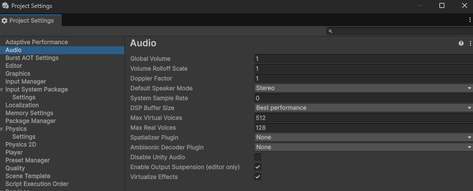
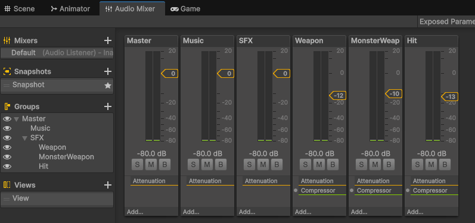
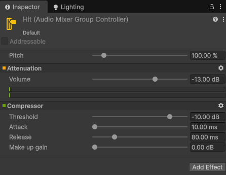

# "맞았는데 소리가 안 나요" — 범인은 하나가 아니라 둘이었다

날짜: 2026-10-14
태그: Unity, 오디오, 디버깅

## 배경

이 게임은 던전앤파이터식 스킬 액션에 서바이버 웨이브를 섞은 장르다. 몬스터가 한 번에 여러 마리 몰려오고, 플레이어의 한 번의 공격이 그중 여러 마리를 동시에 때리는 상황이 기본값이다. 그래서 "맞을 때 소리가 난다"는 모든 공격이 공유하는 `HitSoundManager` 하나로 통합해 두었다 — 공격 수단마다 소리를 따로 심다가 어떤 건 나고 어떤 건 안 나는 걸 막기 위해서였다.

그런데 그 통합 지점에서 다시 "소리가 안 나는" 제보가 들어왔다. 몬스터를 여러 마리 동시에 때리면, 타격 이펙트와 데미지 숫자는 전부 정상인데 타격음 일부만 빠지는 현상이었다. "맞긴 맞았는데 때린 맛이 안 난다"는, 서바이버류에서는 치명적인 체감이었다.

## 문제

처음 의심한 건 믹서 체인이었다. 효과음 버스(`SFX`) 아래에 무기음·몬스터 공격음·타격음이 각각 하위 그룹으로 나뉘어 있었는데, `SFX` 자체에도 Compressor가 걸려 있고 그 하위 그룹들에도 저마다 다이내믹스 이펙트가 걸려 있었다. "컴프레서가 여러 겹으로 쌓여서 서로 간섭하는 게 아닐까"가 첫 가설이었다.

실제로 구조를 열어보니 가설의 절반은 맞고 절반은 틀렸다. 하위 그룹에 걸려있던 건 Compressor가 아니라 Normalize(레벨 자동 평탄화)였다 — 둘 다 "소리 크기를 건드리는" 이펙트라 겹쳐 보였을 뿐, 하는 일은 달랐다. 하지만 `SFX` 버스 레벨의 Compressor는 진짜 문제였다. 이건 **하위 그룹을 전부 합친 신호**에 걸려 있어서, 한 그룹에서 큰 소리가 터지면 다른 그룹에서 겹쳐 들어온 소리까지 같이 눌러버리는 교차 간섭(cross-ducking)을 일으키고 있었다.

여기까지 고치고 나니 음량 뭉개짐은 잡혔는데, "소리가 아예 안 들리는" 증상은 그대로 남았다. 다른 원인이 있다는 뜻이었다.

## 해결 과정

더 파고들자 진짜 범인은 믹서가 아니라 유니티 오디오 엔진의 **보이스 관리 구조**였다. 유니티는 동시에 재생 요청이 들어온 소리가 많아지면, 프로젝트 설정의 `Real Voice Count`(실제로 믹싱해서 스피커로 내보내는 한도)를 넘는 순간부터 우선순위가 낮은 쪽을 "가상화"한다 — 재생 자체는 계속되지만 소리만 꺼지는 것이다. 이 한도가 기본값인 32로 그대로 남아 있었다.

코드를 전수 조사해보니 우선순위도 손을 안 댄 상태였다. 플레이어 자신의 무기 소리만 가장 높은 우선순위로 박혀 있었고, 타격음과 몬스터 공격음은 전부 유니티 기본값으로 동급 경쟁 중이었다. 한 번의 공격으로 몬스터 10마리를 때리면 그 순간 타격음만 10개가 동시에 필요한데, 서로 동급이라 밀어낼 수도 없고, 여기에 다른 소리까지 겹쳐 32를 넘기면 그중 일부가 거의 무작위로 묵음 처리됐다.

처음엔 "타격음 우선순위를 몬스터 공격음보다 높여주면 되지 않을까" 싶었지만, 그걸로는 절반만 풀리는 문제였다. 우선순위는 **서로 다른 카테고리끼리** 경쟁할 때 누가 이기는지를 정할 뿐, 같은 타격음끼리 동시에 여러 개가 필요한 상황에는 의미가 없었다. 몬스터 10마리를 때려서 타격음 10개가 동시에 필요하면, 그 10개는 전부 똑같이 "타격음"이라 서로 경쟁할 수가 없다 — 애초에 보이스 한도 자체가 모자란 것이었다.

그래서 세 가지를 동시에 손봤다.

1. 타격음·몬스터 공격음에 명시적인 우선순위를 줘서, 적어도 서로 다른 카테고리끼리는 밀리지 않게 정리
2. `Real Voice Count`를 32에서 올려서, 여러 마리를 한 번에 때릴 때 필요한 보이스 자체를 늘림 — 48부터 시작해 실제 플레이로 간을 보면서 결국 128까지 올렸다
3. 믹서의 `SFX` 버스 Compressor를 없애고, 그 압축을 각 하위 그룹 안으로 내려서 서로 다른 카테고리가 교차로 누르지 않게 격리

세 번째를 적용한 뒤의 믹서 구조는 이렇다 — `SFX` 버스에는 Attenuation만 남기고, `Weapon`/`MonsterWeapon`/`Hit` 각 그룹에 개별 Compressor를 걸었다.

세 번째는 처음엔 "일단 됐으니 안 건드려도 되지 않나" 싶었는데, Real Voice Count를 128까지 올리고 보니 합쳐진 신호가 0dB를 넘어 소리가 찢어질 위험이 생겼다는 걸 알게 되어 Master 버스에 리미터를 더하는 것도 검토했다 — 이건 아직 실제로 적용하지 않은 다음 과제다.

## 결과 / 배운 점

- **"소리가 재생되는가"와 "소리가 묻히는가"는 완전히 다른 층위의 문제다.** 하나는 유니티 오디오 엔진의 보이스 관리(한도·우선순위), 다른 하나는 믹서 버스 설계(이펙트 체인) 문제였다. 증상만 보면 둘 다 "소리가 씹힌다"로 똑같이 느껴지지만, 원인을 하나로 뭉뚱그려 접근했으면 절반만 고치고 끝났을 것이다.
- **우선순위 조정은 "한도 초과"의 해법이 아니라 "한도 초과 시 누가 이기는가"의 해법이다.** 동시에 필요한 보이스 자체가 한도를 넘는 장르적 특성(한 번에 여러 대상을 때리는 서바이버류)이라면, 결국 한도(`Real Voice Count`) 자체를 올리는 게 먼저다.
- **장르 특성이 곧 테스트 시나리오다.** 몬스터 한두 마리로 테스트했다면 절대 드러나지 않았을 문제였다. "한 번에 여러 대상을 동시에 때리는" 게 핵심 재미인 장르라면, 그 상황을 의도적으로 재현해서 테스트해야 한다는 걸 다시 확인했다.
