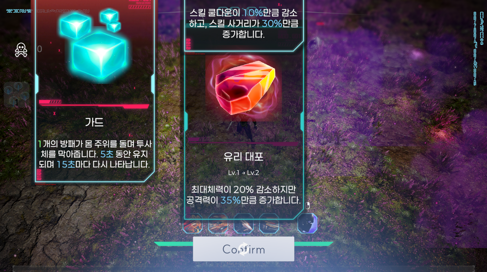
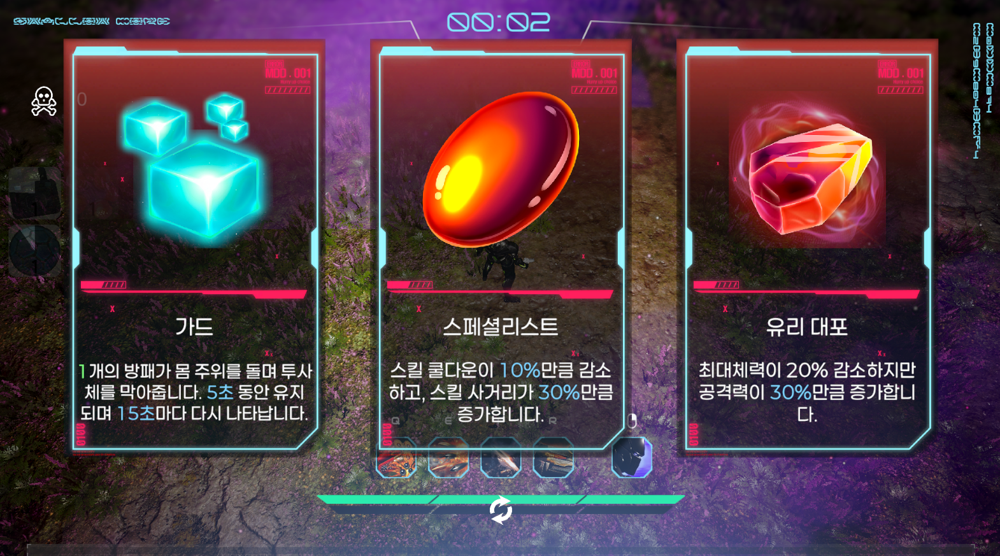

# 카드가 두 겹으로 떴다 — 서로의 존재를 몰랐던 두 개의 리워드 UI

날짜: 2026-10-14
태그: Unity, UI, 디버깅, 동시성

## 배경

이 게임은 레벨업할 때 카드 3장 중 하나를 골라 성장하는 방식 외에, "축복"이라는 두 번째 보상 경로가 있다. 엘리트 몬스터를 처치하면 상자가 드랍되고, 주우면 레벨업 카드와 똑같은 화면 문법(카드 3장이 떨어져서 안착, 확인을 눌러야 닫힘)으로 보상을 보여준다. 둘 다 화면 중앙에 카드 UI가 뜨고 전투를 멈춘다는 점에서 거의 쌍둥이 같은 화면이다.

둘 다 각자 할 일만 하면 되는 단순한 구조처럼 보였다. 레벨업하면 레벨업 카드가 뜨고, 축복을 주우면 축복 카드가 뜬다. 문제는 "둘이 동시에 일어나면 어떻게 되는가"를 아무도 생각해보지 않았다는 것이었다.

## 문제

레벨업과 축복 상자 줍기가 거의 같은 타이밍에 겹치자, 두 카드 화면이 **동시에** 화면에 떴다. 각자의 3장짜리 카드 레이아웃이 서로 다른 위치에 겹쳐 그려지면서, 카드 텍스트가 잘리고 다른 카드의 이미지 위에 또 다른 카드가 포개지는 식으로 화면이 엉망이 됐다.

## 해결 과정

원인을 찾는 건 어렵지 않았다. 레벨업 카드를 띄우는 코드와 축복 카드를 띄우는 코드는 완전히 서로 다른 매니저 클래스(`PlayerManager`, `BlessingManager`)에 있었고, 둘 다 똑같은 패턴으로 동작했다 — "전투를 멈추고, 내 UI를 켠다." 둘 중 어느 쪽도 "지금 다른 보상 UI가 떠 있는가?"를 확인하지 않았다. 레벨업 조건과 축복 상자 픽업이 거의 같은 프레임에 걸리면, 둘 다 자기가 먼저라는 전제로 동시에 화면을 켜버렸다.

제일 먼저 떠오른 방법은 레벨업 카드 쪽에 "축복 카드가 떠 있으면 대기" 같은 조건문을 추가하는 것이었다. 그런데 이러면 축복 카드 쪽에도 "레벨업 카드가 떠 있으면 대기"라는 대칭되는 조건문을 또 넣어야 한다. 지금은 두 종류뿐이라 괜찮아 보이지만, 나중에 업적 팝업처럼 세 번째 보상 UI가 추가되면 서로를 알아야 하는 조건문의 수가 기하급수적으로 늘어난다.

그래서 둘 다 서로를 전혀 몰라도 되는 방향으로 풀었다. 작은 큐 매니저를 하나 만들어서, 레벨업 카드든 축복 카드든 "나 좀 보여줘"라고 요청만 하게 했다. 큐는 지금 아무것도 안 보여주고 있으면 바로 보여주고, 이미 뭔가 떠 있으면 요청을 줄 세워뒀다가 그게 닫히는 순간 다음 요청을 이어서 보여준다. 각 UI는 "내가 완전히 닫혔다"는 신호만 큐에 보내면 되고, 그다음에 뭐가 떠야 하는지는 신경 쓸 필요가 없다.

여기서 한 가지를 더 신경 써야 했다. 레벨업 카드가 닫히자마자 큐가 "다음 걸 보여줄게"라고 하면, 레벨업 카드를 닫으며 재개했던 전투가 한 프레임 만에 다시 멈추는 부자연스러운 깜빡임이 생길 수 있었다. 그래서 "전투 재개"는 큐에게 먼저 물어보고, 대기 중인 다음 요청이 없을 때만 실행하도록 순서를 바꿨다 — 다음 카드가 기다리고 있다면 애초에 재개 자체를 건너뛴다.

## 결과 / 배운 점

- **"각자 자기 일만 하면 된다"는 가정이 가장 위험할 때는, 그 둘이 동시에 일어날 수 있을 때다.** 레벨업과 축복 픽업은 코드상 전혀 관계가 없어 보이지만, 둘 다 "전투를 멈추고 화면 하나를 띄운다"는 같은 자원(화면, 일시정지 상태)을 건드리고 있었다. 서로 다른 시스템이라도 같은 자원을 공유한다면 동시성을 의심해야 한다.
- **N개의 시스템이 서로를 몰라도 되게 만들려면, 서로를 직접 확인하게 하지 말고 공용 조정자를 하나 두는 게 낫다.** 레벨업이 축복을, 축복이 레벨업을 알게 만드는 대신, 둘 다 몰라도 되는 큐 하나를 만들어서 책임을 옮겼다. 다음에 세 번째 보상 UI가 추가돼도 그 UI만 큐를 쓰면 끝난다.
- **"닫혔다"와 "재개한다"를 같은 타이밍으로 묶지 말아야 할 때가 있다.** 둘을 분리해서 "닫힘 → 다음 요청 확인 → 없을 때만 재개" 순서로 바꾸자, 연속으로 뜨는 보상 UI 사이에 전투가 잠깐 깨어났다 다시 잠드는 어색한 깜빡임도 자연스럽게 사라졌다.
