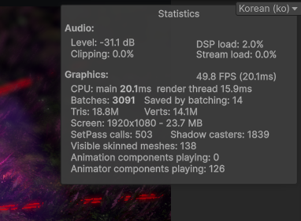
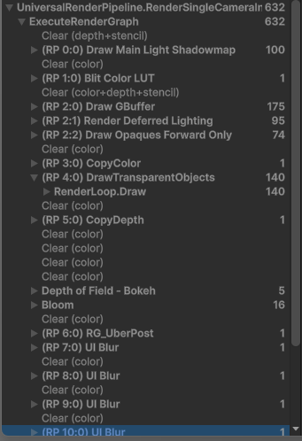
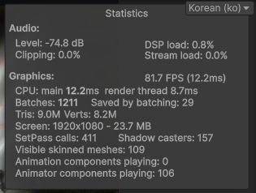

# 몬스터 버그를 막으려고 복제한 재질이, 최적화할 때 발목을 잡았다

날짜: 2026-11-13
태그: Unity, 렌더링, 최적화, GPU 인스턴싱

## 배경

포트폴리오에 넣을 만한 최적화 사례를 만들어보려고, 우선 지금 성능이 어디서 새는지부터 확인하기로 했다. Unity의 Stats 패널로 로비씬과 인게임씬을 각각 찍어봤다.

- 로비씬: 191fps (5.2ms)
- 인게임씬: 49.8fps (20.1ms)

같은 프로젝트인데 인게임만 4배 가까이 느렸다. 몬스터가 몰려오는 서바이버 장르라 어느 정도 느려지는 건 각오했지만, 숫자를 더 들여다보니 이상한 구석이 있었다. 드로우콜(Batches)이 3091개인데 그중 배칭으로 절약된 건 단 14개. 배칭이 아예 안 먹히고 있었다.

## 문제

그림자를 끄고, Animator Culling을 걸고, Unity 6의 새 기능인 GPU Resident Drawer(여러 오브젝트를 GPU에서 한 번에 묶어 그려주는 기능)까지 켜봤다. 프레임은 조금 나아졌는데 Batches/SetPass calls는 기대만큼 안 줄었다.

다음으로 LOD(거리에 따라 저폴리곤 모델로 바꿔치는 기법)를 의심했지만, 이건 애초에 말이 안 되는 접근이었다. 탑뷰/쿼터뷰 게임이라 카메라와 몬스터 사이 거리가 늘 거의 똑같다 — 거리별로 바꿔칠 "거리" 자체가 없는 셈이다. 화면 밖 몬스터를 안 그리는 문제도 이미 해결돼 있었다. Unity는 카메라 시야 밖 오브젝트를 기본으로 안 그리는데, Stats 패널의 "Visible 몬스터 수"가 이미 그 컬링을 거친 숫자였다.

그럼 왜 배칭이 안 걸릴까. 직접 코드를 뒤져보니 범인은 다른 곳에 있었다.

## 해결 과정

`MonsterController`가 몬스터를 스폰할 때마다 몸통 재질을 `new Material(...)`로 매번 복제하고 있었다. 몬스터가 죽을 때 녹아내리는 디졸브 효과, 슈퍼아머 상태의 아웃라인 — 이런 값들이 몬스터마다 달라야 하니, 재질을 복제해서 각자 따로 갖게 만든 것이다.

이 코드를 보자마자 떠오른 게 있었다. 예전에 "몬스터 여러 마리가 재질 하나를 나눠 쓰면 생기는 버그"를 고친 적이 있었는데([관련 글](monster-outline-shared-material-bug.md)), 그때 고친 방법이 바로 이 복제였다. 슈퍼아머 아웃라인이 공유 재질 하나를 같이 보고 있어서 한 마리만 켜도 전부 같이 반짝이던 버그를, "그럼 다 복제해서 각자 갖게 하자"로 해결했던 것이다.

문제는 Unity의 GPU 배칭이 "완전히 같은 재질을 쓰는 오브젝트들"을 묶어서 그리는 방식이라는 것. 몬스터 전부가 서로 다른 재질 인스턴스를 들고 있으니, 애초에 묶일 수 있는 대상이 하나도 없었다. 반년 전에 버그를 막으려고 내린 결정이, 이번 최적화에서는 가장 큰 걸림돌로 돌아온 셈이다.

다행히 둘 다 만족시키는 방법이 있었다 — `MaterialPropertyBlock`. 재질 파일 자체는 몬스터 종류별로 그대로 공유하면서, "이 몬스터만 디졸브 값이 다르다" 같은 덮어쓰기는 렌더러에 붙는 작은 데이터 뭉치로 따로 관리하는 기능이다. 재질을 복제하지 않으니 배칭 조건(같은 재질)이 유지되고, 그러면서도 몬스터마다 다른 값은 그대로 보장된다.

여기에 더해 스폰 이펙트도 하나 걸렸다. Frame Debugger(한 프레임이 실제로 어떤 순서로 그려지는지 전부 펼쳐 보여주는 도구)로 프레임을 분해해보니, 투명 오브젝트 그리기(DrawTransparentObjects) 비중이 꽤 컸다. 몬스터 본체가 아니라 몬스터가 생성될 때 재생되는 파티클 이펙트였다. 이펙트 안의 파티클 시스템 중 절반가량이 GPU 인스턴싱이 꺼진 채로 있었던 것 — 이것도 켜줬다.

## 결과 / 배운 점

몬스터 밀도가 서로 다른 순간을 비교하면 왜곡되니, "몬스터 한 마리당 비용"으로 정규화해서 비교했다. 최적화 전 마리당 CPU 비용 대비, 전부 적용한 뒤에는 약 37% 줄었다.

- **과거의 해결책이 미래의 발목을 잡을 수 있다.** "재질을 복제한다"는 당장 눈앞의 버그(값 공유)는 깔끔하게 막아주지만, 그 복제가 나중에 "배칭이 안 걸린다"는 전혀 다른 문제의 원인이 될 거라고는 당시엔 알 수 없었다. 둘 다 만족시키는 제3의 선택지(`MaterialPropertyBlock`)가 있다는 걸 미리 알았다면 처음부터 그렇게 짰을 것이다.
- **숫자 하나만 보고 판단하면 안 된다.** 재질 공유로 바꾼 직후, 오히려 Batches/SetPass 숫자는 더 늘었다. 그런데 실제 프레임 타임은 줄었다. GPU 인스턴싱이 걸리기 시작하면서 "드로우 하나당 비용"이 훨씬 싸진 거였다 — Stats 패널의 배치 개수만 보고 "더 나빠졌다"고 판단했으면 진짜 원인을 놓칠 뻔했다.
- **"이 장르에선 원래 이런 거다"라고 넘기기 전에, 비슷한 장르 게임들이 실제로 어떻게 푸는지 찾아보는 게 먼저다.** 호드 서바이버 게임들이 수백 마리를 가볍게 그리는 이유는 폴리곤이 적어서가 아니라, 애초에 스켈레탈 애니메이션 자체를 안 쓰거나(2D 스프라이트), 애니메이션을 미리 텍스처로 구워두는(Vertex Animation Texture) 방식을 쓰기 때문이었다. 지금 당장 거기까지 가진 않았지만, "왜 쟤네는 안 그런데 우리는 그럴까"를 구조적으로 짚어보고 나니 다음 단계가 뭔지도 명확해졌다.
